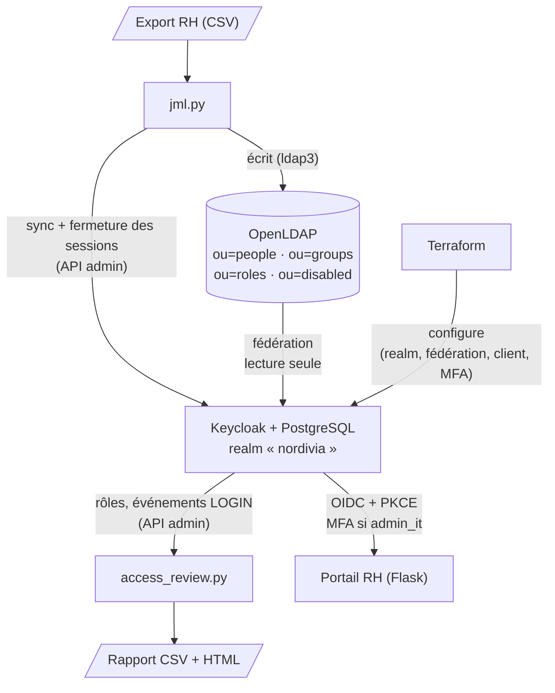
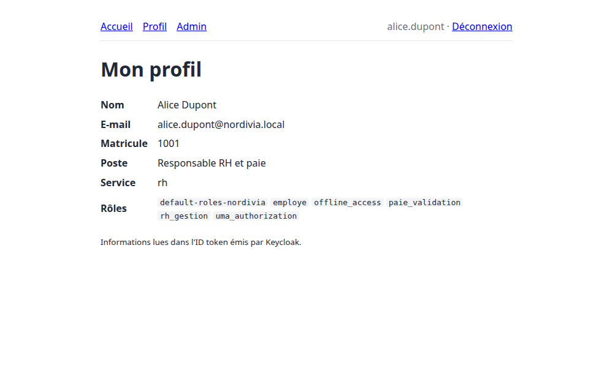
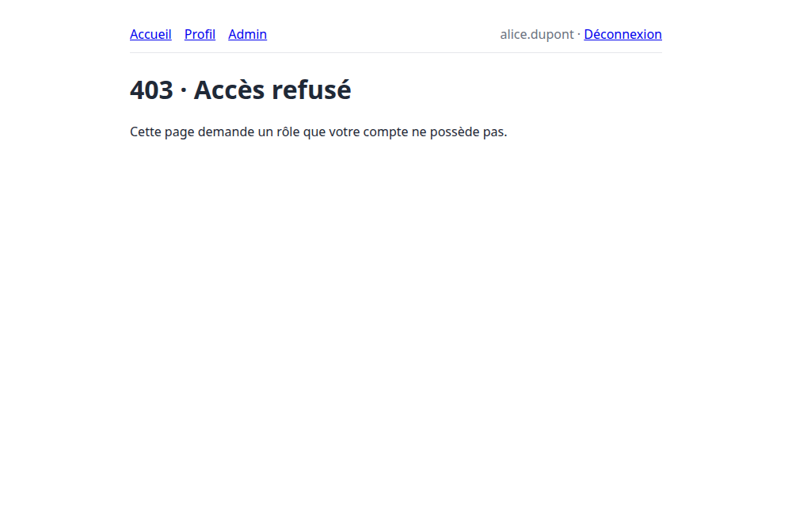
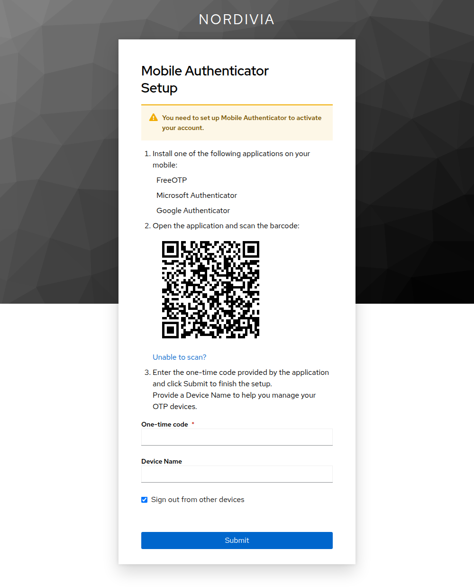
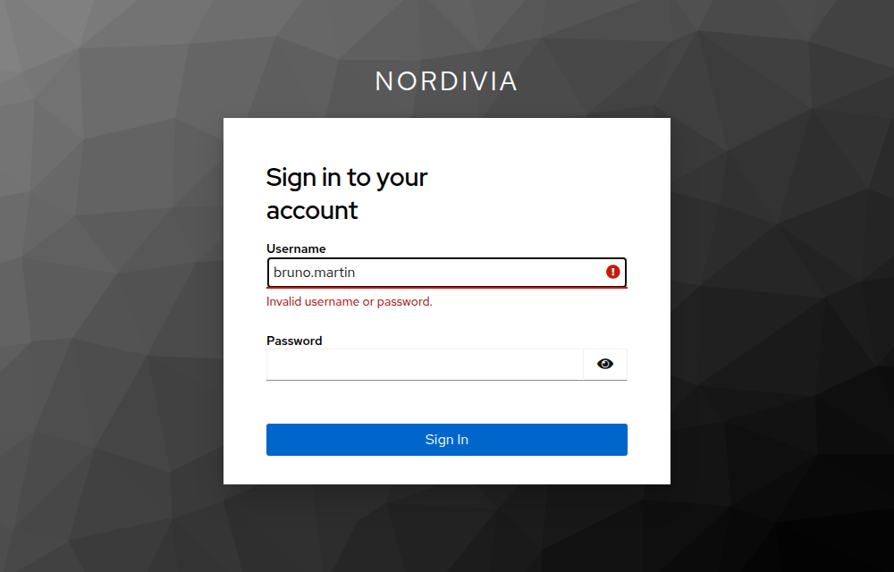
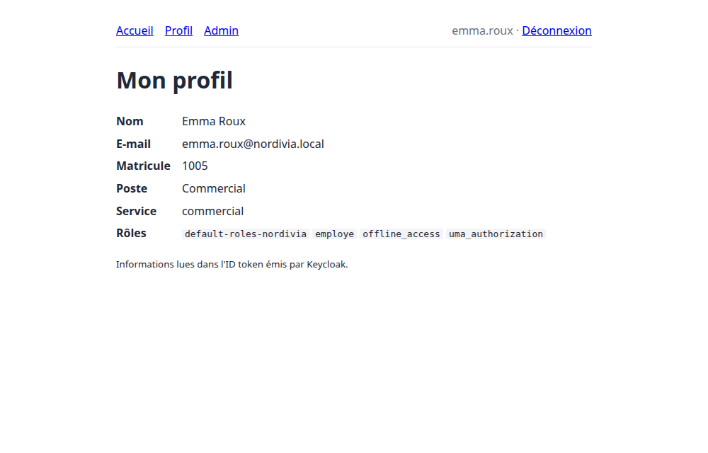
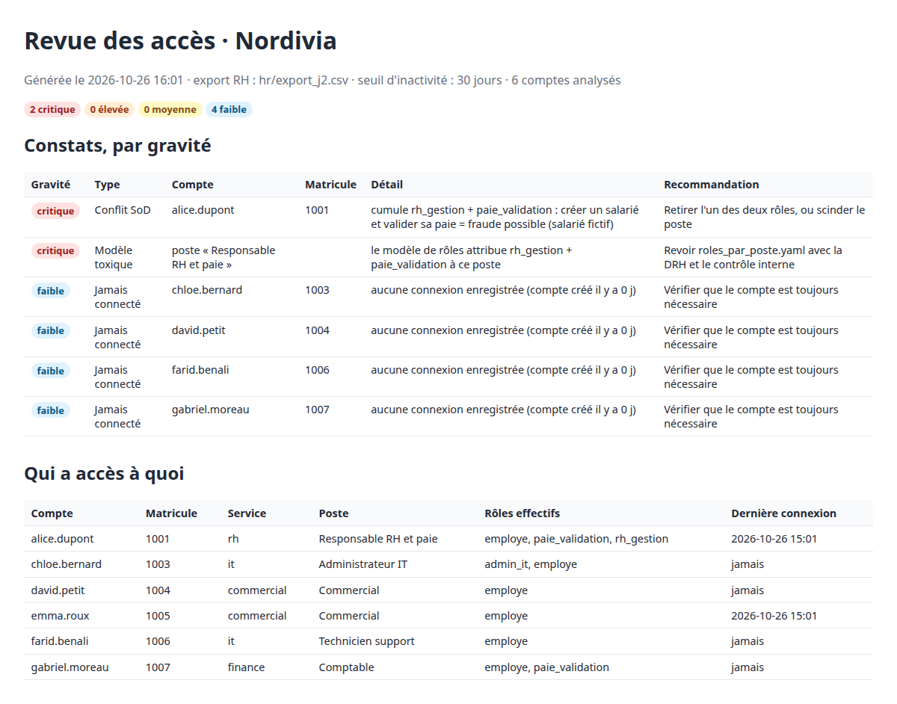

# IAM-in-a-box

Plateforme de gestion des identités et des accès reproductible, pour une PME fictive.
**Keycloak · OpenLDAP · Terraform · OIDC · MFA · Python (ldap3)**

## Contexte

Nordivia est une PME fictive de 50 personnes, réparties en quatre services : RH, Finance, IT et Commercial.
Les comptes y sont créés à la main, application par application. Quand quelqu'un change de poste, il garde ses anciens droits.
Quand quelqu'un part, ses comptes restent actifs. Personne ne sait dire qui a accès à quoi, ni repérer un cumul de droits dangereux.

IAM-in-a-box répond à ces problèmes avec une plateforme déployée en une commande et entièrement décrite en code :

1. un **annuaire LDAP**, source de vérité unique des identités ;
2. l'**authentification unique (SSO)** en OIDC via Keycloak, avec une **MFA imposée aux comptes à privilèges** ;
3. l'**automatisation du cycle de vie** des comptes (arrivées, mobilités, départs) à partir de l'export RH : [`jml.py`](lifecycle/jml.py) ;
4. une **revue des accès** qui détecte les conflits de séparation des tâches, les comptes orphelins, inactifs ou hors modèle : [`access_review.py`](lifecycle/access_review.py).

## Architecture



| Composant | Rôle |
|---|---|
| `docker-compose.yml` | PostgreSQL 16, Keycloak 26.0.8, OpenLDAP 2.6.6 (Bitnami) |
| [`ldap/bootstrap/`](ldap/bootstrap/) | Arbre initial : 4 OU, 6 salariés, 4 services, 4 rôles applicatifs |
| [`terraform/`](terraform/) | Realm, politique de mots de passe, anti-brute-force, événements, fédération LDAP, client OIDC, flux MFA |
| [`app/`](app/) | Portail RH en Flask : client OIDC confidentiel avec PKCE |
| [`lifecycle/`](lifecycle/) | `jml.py`, `access_review.py`, modèle de rôles, règles SoD, exports RH J0 → J2 |

## Choix techniques

**LDAP en lecture seule, source de vérité.**
La fédération Keycloak est en `READ_ONLY` : Keycloak lit l'annuaire mais ne l'écrit jamais. Un seul système fait foi, et un seul outil le modifie : `jml.py`, à partir de l'export RH. Les mots de passe ne sont pas copiés dans Keycloak : chaque connexion est vérifiée par un *bind* LDAP.

**Groupes pour l'organisation, rôles pour les droits (RBAC).**
`ou=groups` décrit qui est où (le service), `ou=roles` décrit qui peut faire quoi. Les droits d'un poste sont définis dans un modèle versionné ([`roles_par_poste.yaml`](lifecycle/config/roles_par_poste.yaml)). On peut donc changer les droits d'un poste sans toucher à l'organigramme, et la revue des accès compare chaque compte à ce modèle.

**Désactiver plutôt que supprimer.**
Au départ d'un salarié, `jml.py` retire tous ses groupes et rôles, puis déplace son entrée vers `ou=disabled`. La fédération ne cherche que sous `ou=people` (`ONE_LEVEL`), donc le compte ne peut plus se connecter, mais la trace reste disponible pour l'audit.

**Fermer les sessions au départ.**
Désactiver le compte ne suffit pas : une session ouverte resterait valide. `jml.py` appelle l'API Keycloak pour déconnecter la personne *avant* de la désactiver. De son côté, le portail vérifie à chaque requête, par introspection du jeton, que la session Keycloak est toujours active.

**MFA portée par le rôle.**
Un flux d'authentification conditionnel impose l'OTP au seul rôle `admin_it`. Quand `jml.py` attribue ce rôle à quelqu'un, la MFA s'applique dès sa connexion suivante, sans autre configuration.

**Configuration en code.**
Tout Keycloak est décrit en Terraform (provider officiel `keycloak/keycloak`). `terraform destroy` puis `terraform apply` reconstruit le même realm, et toute modification manuelle dans la console apparaît au prochain `terraform plan`.

**Idempotence.**
`jml.py` compare l'état voulu (l'export RH) à l'état réel (LDAP) avant d'écrire. Relancé sur le même export, il n'applique aucun changement. Il corrige aussi les dérives, par exemple un rôle ajouté à la main hors modèle.

**Le client OIDC.**
Le portail est un client confidentiel, limité au flux *authorization code* avec PKCE (S256). Le flux implicite et le *password grant*, qui contournerait la MFA, sont désactivés. L'URI de redirection est exacte, sans joker.

## Lancement

Prérequis : Docker et Docker Compose, Terraform ≥ 1.5, Python ≥ 3.11.

```bash
cp .env.example .env        # puis renseigner les valeurs CHANGE_ME (openssl rand -hex 32)
docker compose up -d
cd terraform && set -a && . ../.env && set +a && terraform init && terraform apply
```

Keycloak met environ 30 secondes à démarrer : si `terraform apply` échoue avec une erreur de connexion, il suffit de le relancer. La synchronisation périodique importe les utilisateurs LDAP dans la minute qui suit. On peut aussi la lancer à la main : console → *User federation* → `openldap` → *Sync all users*.

Ensuite, les outils Python :
```bash
python3 -m venv .venv && . .venv/bin/activate
pip install -r app/requirements.txt -r lifecycle/requirements.txt
python app/app.py           # portail sur http://localhost:5000 (pas 127.0.0.1)
```

### Comptes de démonstration

Les six salariés de J0 ont le mot de passe `Nordivia2026!`. Il est stocké haché (`{SSHA}`) dans le LDIF.

| Compte | Poste | Rôles | Accès |
|---|---|---|---|
| `alice.dupont` | Gestionnaire RH | employe, rh_gestion | `/profil` |
| `bruno.martin` | Comptable | employe, paie_validation | `/profil` |
| `chloe.bernard` | Administrateur IT | employe, admin_it | `/profil`, `/admin` (avec OTP) |
| `david.petit` | Commercial | employe | `/profil` |
| `emma.roux` | Gestionnaire RH | employe, rh_gestion | `/profil` |
| `farid.benali` | Technicien support | employe | `/profil` |

## Démonstration

### SSO et MFA

| Profil lu dans l'ID token | 403 sans `admin_it` | Enrôlement OTP imposé à `admin_it` |
|---|---|---|
|  |  |  |

### J0 → J1 : une arrivée, une mobilité, un départ

```text
$ python lifecycle/jml.py lifecycle/hr/export_j1.csv --dry-run
Export : hr/export_j1.csv  (6 actifs, 1 partis)

  ~ modification   1005  emma.roux        service rh → commercial ; poste Gestionnaire RH → Commercial ; -groupe rh ; +groupe commercial ; -rôle rh_gestion
  + création       1007  gabriel.moreau   finance / Comptable ; rôles : employe, paie_validation
  − désactivation  1002  bruno.martin     retrait de : employe, finance, paie_validation ; déplacé vers ou=disabled ; sessions fermées

Plan : 1 création(s), 1 modification(s), 1 désactivation(s).
Mode --dry-run : rien n'a été écrit.
```

Après application :
- Bruno, connecté au portail, est déconnecté immédiatement et ne peut plus se reconnecter ;
- Emma a perdu `rh_gestion` : pas de droits résiduels ;
- Gabriel se connecte avec le mot de passe initial, affiché une seule fois ;
- une seconde exécution répond « aucun changement ».

| Bruno (parti) ne peut plus se connecter | Emma (mutée) n'a plus `rh_gestion` |
|---|---|
|  |  |

Chaque action est tracée dans `lifecycle/logs/jml.csv` (horodatage, matricule, action, état avant, état après).

### J1 → J2 : détection d'un conflit de séparation des tâches

Dans J2, Alice devient « Responsable RH et paie », un poste qui, dans le modèle, cumule `rh_gestion` et `paie_validation`. `jml.py` applique le modèle, et c'est la revue qui lève l'alerte :

```bash
python lifecycle/jml.py lifecycle/hr/export_j2.csv
python lifecycle/access_review.py lifecycle/hr/export_j2.csv --jours 30
```

```text
$ python lifecycle/access_review.py lifecycle/hr/export_j2.csv
6 comptes analysés, 6 constat(s) :
  [critique] Conflit SoD        alice.dupont               cumule rh_gestion + paie_validation : créer un salarié et valider sa paie = fraude possible (salarié fictif)
  [critique] Modèle toxique     poste « Responsable RH et paie » le modèle de rôles attribue rh_gestion + paie_validation à ce poste
  [ faible ] Jamais connecté    chloe.bernard              aucune connexion enregistrée (compte créé il y a 0 j)
  [ faible ] Jamais connecté    david.petit                aucune connexion enregistrée (compte créé il y a 0 j)
  [ faible ] Jamais connecté    farid.benali               aucune connexion enregistrée (compte créé il y a 0 j)
  [ faible ] Jamais connecté    gabriel.moreau             aucune connexion enregistrée (compte créé il y a 0 j)

Rapports : reports/revue_2026-10-26.csv  et  reports/revue_2026-10-26.html
```



La revue produit `reports/revue_AAAA-MM-JJ.csv` pour l'outillage, et une page HTML triée par gravité pour un manager.

| Gravité | Contrôle |
|---|---|
| critique | Conflit de séparation des tâches ([`sod_rules.yaml`](lifecycle/config/sod_rules.yaml)) ; poste du modèle qui viole lui-même une règle |
| élevée | Compte orphelin (absent de l'export RH) ; départ non traité |
| moyenne | Rôle non justifié par le poste ; compte inactif depuis N jours |
| faible | Compte récent jamais connecté |

## Limites

- **HTTP en local, sans TLS** : entre le navigateur et Keycloak comme entre Keycloak et LDAP (`ldap://`, donc les binds circulent en clair sur le réseau Docker).
- **Keycloak en mode `start-dev`**, sans haute disponibilité ; un seul nœud pour chaque service.
- **Image OpenLDAP figée** (`bitnamilegacy/openldap:2.6.6`, plus maintenue).
- **Secrets dans un `.env`**, et en clair dans le `terraform.tfstate` local.
- **Keycloak se connecte à LDAP avec `cn=admin`** au lieu d'un compte de service en lecture seule.
- **Les événements sont conservés 30 jours** : au-delà, la détection d'inactivité n'est pas fiable.
- `jml.py` ignore `date_effet` (tout est appliqué immédiatement) et ne propage pas les changements de nom ou d'e-mail. Un retour après un départ se traite à la main.
- En `READ_ONLY`, un nouvel arrivant ne peut pas changer son mot de passe initial depuis Keycloak.
- Un utilisateur dont la session SSO existait avant l'attribution de `admin_it` n'est soumis à l'OTP qu'à sa reconnexion (pas d'authentification *step-up*).

**En production** : TLS partout (LDAPS), Keycloak en cluster derrière un reverse proxy, secrets et state Terraform dans un coffre-fort (Vault, backend chiffré), compte de service LDAP dédié, événements envoyés vers un SIEM, et `jml.py` branché sur le SIRH avec gestion des dates d'effet.
